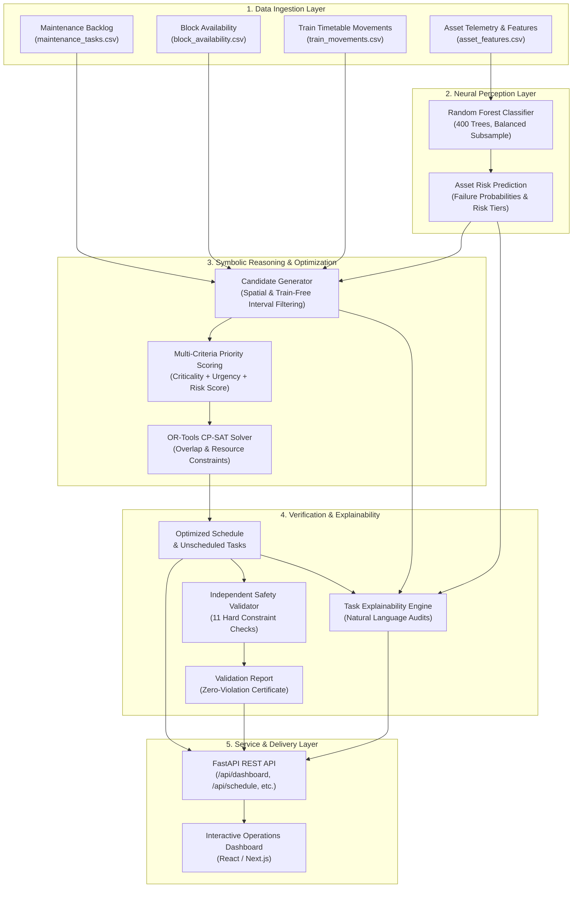

# RailBlock: Neuro-Symbolic AI for Railway Maintenance Scheduling & Risk Prediction

RailBlock is an intelligent railway operations system that combines machine learning (probabilistic asset risk prediction) with symbolic constraint programming (Google OR-Tools CP-SAT) and automated verification. The system schedules track and asset maintenance within scarce block availability windows while strictly preventing train collisions, adhering to operational deadlines, and generating natural-language explanations for human dispatchers.

---

## Table of Contents
1. [Overview & Neuro-Symbolic Motivation](#overview--neuro-symbolic-motivation)
2. [System Architecture](#system-architecture)
3. [End-to-End Workflow](#end-to-end-workflow)
4. [Component Deep Dive](#component-deep-dive)
   - [1. Data Layer](#1-data-layer)
   - [2. Machine Learning Engine (Neural Component)](#2-machine-learning-engine-neural-component)
   - [3. Candidate Generator (Symbolic Pre-Filter)](#3-candidate-generator-symbolic-pre-filter)
   - [4. CP-SAT Optimization Engine (Symbolic Reasoner)](#4-cp-sat-optimization-engine-symbolic-reasoner)
   - [5. Independent Validation Engine (Safety Verifier)](#5-independent-validation-engine-safety-verifier)
   - [6. Explainability Engine (XAI)](#6-explainability-engine-xai)
   - [7. FastAPI Backend & REST Endpoints](#7-fastapi-backend--rest-endpoints)
   - [8. Frontend Interface](#8-frontend-interface)
5. [Project Directory Structure](#project-directory-structure)
6. [Mathematical Formulation](#mathematical-formulation)
7. [Experimental Results & Verification Report](#experimental-results--verification-report)
8. [Setup and Execution Guide](#setup-and-execution-guide)

---

## Overview & Neuro-Symbolic Motivation

Modern railway networks face a critical challenge: tracks and signaling assets experience continuous mechanical wear and require timely maintenance, but maintenance blocks necessitate track closures that compete with dense train timetables.

Traditional approaches fail because:
- **Purely Reactive or Rule-Based Maintenance** misses subtle pre-failure degradation patterns across multivariate asset telemetry.
- **Pure Deep Learning / Machine Learning** can predict asset failure probabilities, but neural models cannot enforce hard physical invariants (such as zero train collisions, non-overlapping track occupations, and exact maintenance durations).
- **Pure Operations Research (MILP/CP)** can find mathematically optimal schedules against constraints, but has no innate capability to estimate multivariate failure risks from telemetry or explain decisions intuitively.

### The Neuro-Symbolic Paradigm in RailBlock

RailBlock bridges empirical machine learning with formal symbolic reasoning:
- **The Neural Component (Random Forest)** acts as the **Perception Engine**: it learns non-linear risk patterns across 23 asset health and historical telemetry features, outputting calibrated failure probabilities.
- **The Symbolic Component (OR-Tools CP-SAT)** acts as the **Cognitive & Constraint Engine**: it translates risk probabilities into an objective function, calculates dynamic train-free intervals, and enforces non-negotiable physical constraints.
- **The Symbolic Verifier** acts as an **Independent Safety Barrier**: it rigorously audits output schedules against raw input constraints before operational dispatch.
- **The Explainability Layer (XAI)** demystifies optimization decisions into clear, audit-ready natural language explanations.

---

## System Architecture



---

## End-to-End Workflow

The RailBlock pipeline operates through five sequential stages:

```mermaid
sequenceDiagram
    autonumber
    participant D as Data Sources
    participant ML as ML Risk Model
    participant CG as Candidate Generator
    participant OPT as CP-SAT Optimizer
    participant VAL as Safety Validator
    participant EXP as Explainer Engine
    participant API as FastAPI Backend

    D->>ML: Asset features & maintenance history
    ML->>ML: Predict failure probabilities (0.0 to 1.0)
    ML-->>CG: outputs/risk_predictions.csv

    D->>CG: Tasks, block windows & train movements
    CG->>CG: Merge blocks by section & compute train-free gaps
    CG->>CG: Filter by duration, earliest start & deadline
    CG-->>OPT: outputs/candidate_assignments.csv

    OPT->>OPT: Instantiate IntervalVars & priority objective
    OPT->>OPT: Enforce AddNoOverlap and single-task selection
    OPT->>OPT: Solve CP-SAT model (OPTIMAL)
    OPT-->>VAL: outputs/optimized_schedule.csv
    OPT-->>EXP: outputs/unscheduled_tasks.csv

    VAL->>VAL: Run 11 independent ground-truth verification checks
    VAL-->>API: outputs/validation_report.json

    EXP->>EXP: Synthesize composite scores & reason codes
    EXP-->>API: outputs/task_explanations.csv

    API-->>API: Serve endpoints for dashboard, timetable & audit logs
```

---

## Component Deep Dive

### 1. Data Layer
Located in `data/raw/` and `data/synthetic/`:
- **`maintenance_tasks.csv`**: Contains maintenance requirements including `task_id`, `asset_id`, `section_id`, `department` (Engineering, S&T, Traction), `criticality`, `urgency`, `estimated_duration_min`, `earliest_start`, and `deadline`.
- **`block_availability.csv`**: Maintenance blocks designated per section with `block_window_id`, `date`, `start_time`, `end_time`, and `availability_status`. Includes overnight rollover handling.
- **`train_movements.csv`**: Active train timetable across track sections with exact `entry_time` and `exit_time`.
- **`asset_features.csv`**: Asset engineering parameters, installation year, age, cumulative downtimes, failure frequencies, and historical defect counts.

### 2. Machine Learning Engine (Neural Component)
Implemented in `ml/training/train_model.py` and `ml/prediction/predict_risk.py`:
- **Architecture**: Scikit-Learn `Pipeline` with a `ColumnTransformer` (median imputer for numerical values, most-frequent imputer and `OneHotEncoder` for categoricals) feeding into a `RandomForestClassifier`.
- **Hyperparameters**:
  - `n_estimators`: 400
  - `min_samples_leaf`: 2
  - `class_weight`: `"balanced_subsample"` (to handle rare failure events)
  - `random_state`: 42
- **Features (23 total)**: `department`, `asset_type`, `section_id`, `criticality`, `installation_year`, `age_years`, `days_since_last_maintenance`, `has_maintenance_history`, defect counts (90d, 180d, 365d), failure counts (180d, 365d), average downtime, severity scores, and frequency metrics.
- **Target**: `failure_in_next_90d` (binary 0/1).
- **Validation**: Temporal out-of-time evaluation using chronological snapshots to prevent data leakage.
- **Risk Categorization**:
  - **Critical**: $\ge 75\%$ failure probability
  - **High**: $50\% - 74.99\%$ failure probability
  - **Medium**: $25\% - 49.99\%$ failure probability
  - **Low**: $< 25\%$ failure probability

### 3. Candidate Generator (Symbolic Pre-Filter)
Implemented in `optimization/candidate_generator.py`:
- **Spatial Alignment**: Restricts task candidates strictly to blocks located in the identical railway section (`section_id`).
- **Dynamic Train-Free Gap Detection**: Intersects train timetable movements with block windows. Overlapping trains are merged into occupied intervals, leaving feasible free intervals:
  $$\text{Free Intervals} = [t_{\text{block\_start}}, t_{\text{block\_end}}] \setminus \bigcup_{k} [t_{\text{entry}, k}, t_{\text{exit}, k}]$$
- **Temporal Validity**: Validates that task duration fits inside the free interval while honoring $[t_{\text{earliest\_start}}, t_{\text{deadline}}]$.
- **Output**: Writes all valid pairings to `outputs/candidate_assignments.csv`.

### 4. CP-SAT Optimization Engine (Symbolic Reasoner)
Implemented in `optimization/optimizer.py`, `optimization/constraints.py`, and `optimization/objective.py`:
- Built on **Google OR-Tools CP-SAT** constraint solver.
- **Decision Variables**:
  - $x_i \in \{0, 1\}$: Binary variable indicating whether candidate assignment $i$ is selected.
  - $s_i \in [\text{earliest\_start}_i, \text{latest\_start}_i]$: Integer variable for task start minute.
  - $I_i = \text{OptionalIntervalVar}(s_i, \text{duration}_i, s_i + \text{duration}_i, x_i)$: CP-SAT interval variable.
- **Constraints**:
  1. **Single Execution**: A maintenance task $T$ can be scheduled at most once:
     $$\sum_{i \in \text{Candidates}(T)} x_i \le 1 \quad \forall T$$
  2. **Track Block Non-Overlap**: No two maintenance operations can occupy the same block window simultaneously:
     $$\text{NoOverlap}(\{I_i \mid \text{block}(i) = B\}) \quad \forall B$$
- **Objective Function**:
  $$\max \sum_{i} \text{PriorityScore}_i \cdot x_i$$
  where:
  $$\text{PriorityScore}_i = w_{\text{criticality}} + w_{\text{urgency}} + \text{round}(P(\text{failure}) \times 100)$$

| Attribute | Level | Weight |
|---|---|---|
| **Criticality** | Critical | 100 |
| | High | 70 |
| | Medium | 40 |
| | Low | 20 |
| **Urgency** | High | 50 |
| | Medium | 25 |
| | Low | 10 |
| **ML Risk** | Continuous $[0.0, 1.0]$ | $0 \text{ to } 100$ |

- **Execution**: Solves using multi-threaded search (`num_search_workers=8`) with a 60-second limit, outputting `outputs/optimized_schedule.csv` and `outputs/unscheduled_tasks.csv`.

### 5. Independent Validation Engine (Safety Verifier)
Implemented in `optimization/validator.py`:
Independent auditing layer that guarantees formal safety by testing the schedule against raw source datasets (`data/raw/`):
1. **Duplicate Tasks**: Zero tasks appear more than once.
2. **Task Existence**: All scheduled tasks exist in `maintenance_tasks.csv`.
3. **Block Existence**: All assigned blocks exist in `block_availability.csv`.
4. **Positive Duration**: Scheduled end time is strictly greater than start time.
5. **Exact Duration Matching**: $(\text{scheduled\_end} - \text{scheduled\_start}) == \text{estimated\_duration\_min}$.
6. **Earliest Start Compliance**: $\text{scheduled\_start} \ge \text{earliest\_start}$.
7. **Deadline Compliance**: $\text{scheduled\_end} \le \text{deadline}$.
8. **Section Matching**: Task section == Block section == Schedule section.
9. **Block Availability**: Assigned block status is strictly `'available'`.
10. **Block Timing**: Entire maintenance window is contained within $[t_{\text{block\_start}}, t_{\text{block\_end}}]$.
11. **Maintenance Non-Overlap**: Zero simultaneous tasks within the same block.
12. **Train Collision Freedom**: Absolute clearance from all train movements:
    $$[\text{scheduled\_start}, \text{scheduled\_end}] \cap [\text{train\_entry}, \text{train\_exit}] = \emptyset$$

### 6. Explainability Engine (XAI)
Implemented in `explanation/task_explainer.py`:
Produces transparent, plain-English rationales for dispatchers and maintenance supervisors:
- **Scheduled Tasks**: Describes the assigned block, section, execution window, task priority score, and breakdown of criticality, urgency, and ML risk probability.
- **Unscheduled Tasks**:
  - `NO_FEASIBLE_BLOCK`: Identifies that no block window offered sufficient uninterrupted train-free duration before the task's deadline.
  - `NOT_SELECTED_BY_OPTIMIZER`: Explains that feasible slots existed, but the optimizer prioritized other tasks with higher combined criticality and risk scores under limited track capacity.

### 7. FastAPI Backend & REST Endpoints
Implemented in `backend/app.py` and `backend/routes/`:
- **`GET /` & `/api/health`**: Health status and project metadata.
- **`GET /api/dashboard`**: Overall KPI metrics (scheduled tasks, coverage %, block utilization, risk distribution, validation status).
- **`GET /api/risks` & `/api/risks/{asset_id}`**: Asset risk predictions and failure probabilities.
- **`GET /api/schedule`**: List of all approved scheduled maintenance blocks.
- **`GET /api/unscheduled`**: Tasks that could not be scheduled with reason codes.
- **`GET /api/tasks` & `/api/tasks/{task_id}`**: Backlog maintenance task details.
- **`GET /api/explanations` & `/api/explanations/{task_id}`**: Natural language reasoning per task.
- **`GET /api/validation`**: Full ground-truth validation report and check status.

### 8. Frontend Interface
Located in `frontend/src/`:
- **`components/Dashboard/`**: Overview KPIs, coverage percentages, and violation alerts.
- **`components/RiskAnalysis/`**: Asset health distributions and high-risk equipment alerts.
- **`components/Schedule/`**: Timetable and Gantt visualization for track block occupancy.
- **`components/TaskManagement/`**: Backlog task filtering by section and department.
- **`components/Explanations/`**: Interactive task audit cards with human-readable rationale.
- **`components/Charts/`**: Departmental workloads and block utilization visuals.
- **`services/api.js`**: Axios client configured for FastAPI backend services.

---

## Project Directory Structure

```text
Neuro_symbolic AI/
├── backend/                         # FastAPI Application & REST Services
│   ├── app.py                       # Application factory & CORS configuration
│   ├── config.py                    # Centralized project paths and settings
│   ├── requirements.txt             # Python dependencies
│   ├── routes/                      # API Endpoints
│   │   ├── dashboard.py             # KPI overview endpoint
│   │   ├── explanations.py          # Explainability endpoints
│   │   ├── risk.py                  # ML risk prediction endpoints
│   │   ├── schedule.py              # Schedule & unscheduled endpoints
│   │   ├── tasks.py                 # Task backlog endpoints
│   │   └── validation.py            # Safety verification endpoint
│   ├── services/                    # Business service handlers
│   └── utils/
│       ├── data_loader.py           # Ingestion, validation & timestamp parsing
│       └── response_formatter.py    # Sanitization and JSON formatters
│
├── frontend/                        # React / Next.js User Interface
│   ├── package.json                 # Node dependencies
│   ├── public/                      # Static assets
│   └── src/
│       ├── components/              # Modular UI components
│       │   ├── Charts/
│       │   ├── Dashboard/
│       │   ├── Explanations/
│       │   ├── RiskAnalysis/
│       │   ├── Schedule/
│       │   └── TaskManagement/
│       ├── hooks/                   # Custom React hooks
│       ├── pages/                   # Application views
│       ├── services/
│       │   └── api.js               # API client
│       ├── styles/                  # CSS / Tailwind styles
│       └── utils/                   # Frontend helpers
│
├── ml/                              # Machine Learning Module (Neural)
│   ├── models/
│   │   └── risk_random_forest.joblib# Serialized trained Random Forest pipeline
│   ├── outputs/
│   │   └── risk_predictions.csv     # Model predictions & risk classifications
│   ├── prediction/
│   │   ├── inspect_model.py         # Model inspection utility
│   │   └── predict_risk.py          # Inference script on asset features
│   └── training/
│       ├── evaluate_model.py        # Out-of-time evaluation metrics
│       ├── preprocessing.py         # Feature engineering pipeline
│       └── train_model.py           # Training script with temporal validation
│
├── optimization/                    # Operations Research & Symbolic Reasoning
│   ├── candidate_generator.py       # Free-interval extraction & candidate generation
│   ├── constraints.py               # CP-SAT overlap and single-assignment constraints
│   ├── objective.py                 # Multi-criteria priority score formulation
│   ├── optimizer.py                 # Google OR-Tools CP-SAT solver implementation
│   └── validator.py                 # Independent ground-truth safety verification
│
├── explanation/                     # Explainable AI (XAI)
│   ├── schedule_explainer.py        # Schedule-level summary generator
│   └── task_explainer.py            # Task-level natural language explanation engine
│
├── data/
│   ├── raw/                         # Primary operational datasets
│   │   ├── block_availability.csv   # Track block windows (357 blocks)
│   │   ├── maintenance_tasks.csv    # Maintenance task backlog (108 tasks)
│   │   └── train_movements.csv      # Train timetable movements (560 movements)
│   ├── processed/                   # Staged feature data
│   └── synthetic/                   # Telemetry, asset master & history datasets
│
├── outputs/                         # Pipeline Execution Results
│   ├── candidate_assignments.csv    # 402 valid candidate slots generated
│   ├── optimized_schedule.csv       # 64 successfully scheduled tasks
│   ├── risk_predictions.csv         # Risk probabilities for 108 assets
│   ├── task_explanations.csv        # Explanations for all 108 tasks
│   ├── unscheduled_tasks.csv        # 44 unscheduled tasks with reason codes
│   └── validation_report.json       # Formal verification certificate
│
├── tests/                           # Unit & Integration Tests
│   ├── test_ml.py
│   ├── test_optimizer.py
│   └── test_validator.py
│
├── main.py                          # Pipeline entry point
├── requirements.txt                 # Project dependencies
└── README.md                        # Documentation
```

---

## Mathematical Formulation

### 1. Multi-Criteria Priority Formulation
For each candidate assignment $i$ representing task $T$:
$$\text{Score}_i = W_{\text{criticality}}(T) + W_{\text{urgency}}(T) + \left\lfloor 100 \cdot P_{\text{failure}}(A_T) + 0.5 \right\rfloor$$
where $A_T$ is the asset associated with task $T$.

### 2. Constraint Programming Formulation (CP-SAT)
Let $\mathcal{C}$ be the set of all candidate assignments, and $\mathcal{T}$ be the set of tasks.
For candidate $i \in \mathcal{C}$:
- $x_i \in \{0, 1\}$ is a Boolean decision variable.
- $s_i \in [\text{earliest\_start}_i, \text{latest\_start}_i]$ is the start time in minutes.
- $d_i = \text{duration}_i$ is the fixed duration.
- $I_i = \text{OptionalIntervalVar}(s_i, d_i, s_i + d_i, x_i)$ is the execution interval.

$$\max_{x, s} \sum_{i \in \mathcal{C}} \text{Score}_i \cdot x_i$$

Subject to:
1. **Uniqueness**:
   $$\sum_{i \in \mathcal{C}(T)} x_i \le 1 \quad \forall T \in \mathcal{T}$$
2. **Non-Overlapping Blocks**:
   $$\text{NoOverlap}\left(\{I_i \mid i \in \mathcal{C}, \text{block}(i) = B\}\right) \quad \forall B \in \mathcal{B}$$
3. **Train Path Safety**:
   $$\forall i \in \mathcal{C}, \quad [s_i, s_i + d_i] \subseteq \text{FreeIntervals}(B, \text{Trains}_{\text{section}(i)})$$

---

## Experimental Results & Verification Report

Executing the end-to-end RailBlock pipeline produces the following operational results:

```text
==================================================
           RAILBLOCK EXECUTION SUMMARY
==================================================
Total Backlog Tasks:             108
Available Track Blocks:          357
Track Sections:                  16
Active Train Timetables:         560
Feasible Candidate Windows:      402
--------------------------------------------------
Solver Status:                   OPTIMAL
Tasks Scheduled:                 64 (59.26% coverage)
Track Blocks Utilized:           62
Average Scheduled Asset Risk:    8.18%
Tasks Unscheduled:               44
  - No Feasible Block / Train:   40
  - Optimizer Capacity Cut:      4
--------------------------------------------------
Independent Verification:        PASSED (0 Violations)
  - Duplicate Tasks Check:       PASSED
  - Task Timing Check:           PASSED
  - Deadline Check:              PASSED
  - Exact Duration Check:        PASSED
  - Section Alignment Check:     PASSED
  - Block Availability Check:    PASSED
  - Block Containment Check:     PASSED
  - Block Non-Overlap Check:     PASSED
  - Train Collision Check:       PASSED
  - Task Existence Check:        PASSED
  - Block Existence Check:       PASSED
==================================================
```

### Sample Generated Explanation
```text
Task MT0002 was selected by the risk-aware optimizer and assigned to block BW00136 
in section SEC012. The maintenance interval is from 07-01-2026 01:01 to 07-01-2026 02:16. 
The task has high criticality and low urgency. The Random Forest predicted a 7.82% 
failure probability, classified as Low risk. Its calculated priority score is 88. 
The selected assignment was feasible under the candidate-generation rules and the 
optimizer's implemented constraints.
```

---

## Setup and Execution Guide

### Prerequisites
- Python 3.10, 3.11, or 3.12 (Python 3.14 compatible)
- Node.js 18+ and npm (for frontend development)

### 1. Installation
Clone the repository and install Python dependencies:
```bash
pip install -r requirements.txt
```

### 2. Run the Full Neuro-Symbolic Pipeline
Execute each stage in sequential order:

```bash
# Step 1: Predict asset failure probabilities using Random Forest
python -m ml.prediction.predict_risk

# Step 2: Generate feasible, collision-free candidate windows
python -m optimization.candidate_generator

# Step 3: Run the OR-Tools CP-SAT optimizer
python -m optimization.optimizer

# Step 4: Run independent formal safety validation
python -m optimization.validator

# Step 5: Generate natural language explainability reports
python -m explanation.task_explainer
```

### 3. Start the FastAPI Server
Launch the REST API:
```bash
uvicorn backend.app:app --reload --host 127.0.0.1 --port 8000
```
- Interactive Swagger API Documentation: [http://127.0.0.1:8000/docs](http://127.0.0.1:8000/docs)
- Alternative ReDoc Documentation: [http://127.0.0.1:8000/redoc](http://127.0.0.1:8000/redoc)
- Health Check: [http://127.0.0.1:8000/api/health](http://127.0.0.1:8000/api/health)

### 4. Retrain the Machine Learning Model
To retrain the Random Forest on new telemetry snapshots:
```bash
python -m ml.training.train_model
```

---

## License
Developed as part of the 5th Semester Mini Project on **Neuro-Symbolic AI for Railway Block Planning**.

